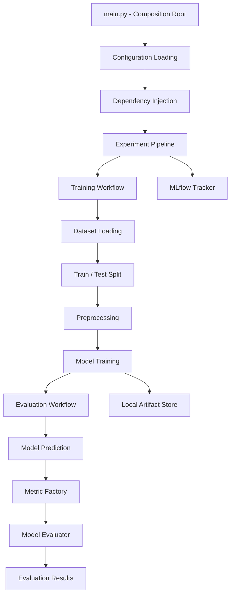

# Mini MLOps — Training & Experiment Management System

A modular Python application for managing machine learning training, evaluation, artifact storage, and experiment tracking.

## Quick Start

### 1. Install dependencies

```bash
uv sync --locked
```

### 2. Run tests

```bash
uv run pytest tests/ -v
```

### 3. Configure MLflow

Create a `.env` file in the project root:

```env
MLFLOW_TRACKING_URI=http://127.0.0.1:5000
```

### 4. Start the MLflow tracking server

```bash
uv run mlflow ui --host 127.0.0.1 --port 5000
```

### 5. Run the application

In another terminal:

```bash
uv run python -m mini_mlops.main
```

Open the MLflow UI:

[http://127.0.0.1:5000](http://127.0.0.1:5000)

---

## Overview

Mini MLOps is a learning-oriented MLOps engineering project focused on building a maintainable and extensible machine learning training system rather than optimizing a single predictive model.

The application manages the core stages of an ML experiment:

- Dataset loading and splitting.
- Configurable preprocessing.
- Model creation and training.
- Model evaluation using multiple metrics.
- Local artifact persistence.
- Experiment tracking using MLflow.

The project follows a modular architecture built around separation of concerns, dependency injection, and interchangeable components.

## Dataset & Models

**Dataset:** Scikit-learn Wine Recognition Dataset.

| Property | Value |
|---|---:|
| Samples | 178 |
| Features | 13 |
| Classes | 3 |
| Training split | 80% |
| Testing split | 20% |

**Supported models:**
- Logistic Regression
- Random Forest Classifier

**Preprocessing strategies:**
- StandardScaler
- No Scaling

**Evaluation metrics:**
- Accuracy
- Weighted Precision
- Weighted Recall
- Weighted F1-score

## Architecture

The application is organized into independent components, each responsible for a specific part of the ML lifecycle.

```text
src/mini_mlops/
│
├── config/
├── data/
├── models/
├── preprocessing/
├── factories/
├── evaluation/
├── adapters/
├── workflows/
├── utils/
└── main.py
```

### Training & Evaluation Flow



## Key Engineering Decisions

### 1. Separation of Concerns (SRP)

Each component has a focused responsibility.

| Component | Responsibility |
|---|---|
| DatasetLoader | Load the dataset |
| TrainTestSplitter | Split training and testing data |
| ModelFactory | Create model instances |
| PreprocessingStrategy | Define preprocessing behavior |
| ModelEvaluator | Calculate evaluation metrics |
| MetricFactory | Create metric implementations |
| ArtifactStore | Persist local artifacts |
| MLflowTracker | Track experiments |
| TrainingWorkflow | Coordinate model training |
| EvaluationWorkflow | Coordinate model evaluation |
| ExperimentPipeline | Coordinate the training and evaluation lifecycle |

This keeps individual components easier to test, maintain, and replace.

### 2. Protocol-Based Design

Protocols are used to define behavioral contracts between components.

This approach relies on structural typing rather than requiring concrete implementations to inherit from a common base class.

It allows implementations to be replaced as long as they satisfy the expected interface.

### 3. Dependency Injection

Dependencies are injected through constructors rather than instantiated inside business workflows.

`main.py` acts as the Composition Root, responsible for creating concrete implementations and wiring the application together.

This reduces coupling and makes components easier to test independently.

### 4. Strategy Pattern

Preprocessing behavior is separated from the training workflow.

Different preprocessing strategies can be selected without modifying the training logic.

### 5. Factory Pattern

Factories handle object creation and selection.

- ModelFactory creates the requested ML model.
- MetricFactory creates the requested evaluation metrics.

Adding supported implementations does not require embedding model-specific or metric-specific creation logic inside the workflows.

### 6. Artifact Storage Abstraction

Model persistence is separated from the training process through an ArtifactStore contract.

The current implementation uses LocalArtifactStore.

This creates a clear extension point for alternative storage backends without coupling the training workflow to a specific storage technology.

### 7. Experiment Lifecycle Management

An experiment tracking decorator manages the MLflow run lifecycle:

- Starts an experiment run.
- Logs configuration parameters.
- Executes the experiment pipeline.
- Marks the run as FINISHED or FAILED.
- Ensures the run is closed after execution.

This keeps run lifecycle management separate from the main training and evaluation logic.

## Data Leakage Prevention

Preprocessing is fitted exclusively on the training data.

```python
X_train = processor.fit_transform(X_train)
X_test = processor.transform(X_test)
```

The test data never participates in learning preprocessing parameters.

This ensures that evaluation is performed on data that was not used to fit the preprocessing transformation.

A fixed random state is also used for reproducible train/test splitting.

## Experiment Tracking

MLflow is integrated through a dedicated tracking adapter.

Each executed experiment records:

- Experiment parameters.
- Evaluation metrics.
- Trained model.
- Run status and execution information.

This makes experiment results accessible through the MLflow UI instead of relying only on console output.

## Testing

The project uses Pytest to validate individual components and their interactions.

The test suite covers:

- Configuration validation and error handling.
- Dataset loading.
- Model factory behavior.
- Preprocessing strategies.
- Artifact persistence.
- Dependency injection.
- Evaluation workflow.
- Experiment tracker operations.

Run the complete test suite:

```bash
uv run pytest tests/ -v
```

## Technology Stack

| Technology | Purpose |
|---|---|
| Python 3.12 | Application development |
| uv | Dependency and environment management |
| Scikit-learn | Machine learning models and preprocessing |
| NumPy / Pandas | Data handling |
| Joblib | Model serialization |
| MLflow | Experiment tracking and model logging |
| Pytest | Automated testing |
| Protocols | Component contracts and structural typing |

## Current Scope & Roadmap

The current implementation supports a complete single-experiment training and evaluation lifecycle with MLflow tracking.

Planned improvements:

- [ ] Docker containerization.
- [ ] Docker Compose integration.
- [ ] CI/CD using GitHub Actions.
- [ ] Multiple Experiment Orchestration.
- [ ] Independent MLflow runs for multiple model configurations.
- [ ] Experiment comparison and result analysis.
- [ ] Reusable inference artifacts containing both the fitted preprocessing component and trained model.

---

**Project Focus:** Building reliable, modular, and reproducible ML training infrastructure through practical software engineering and MLOps principles.